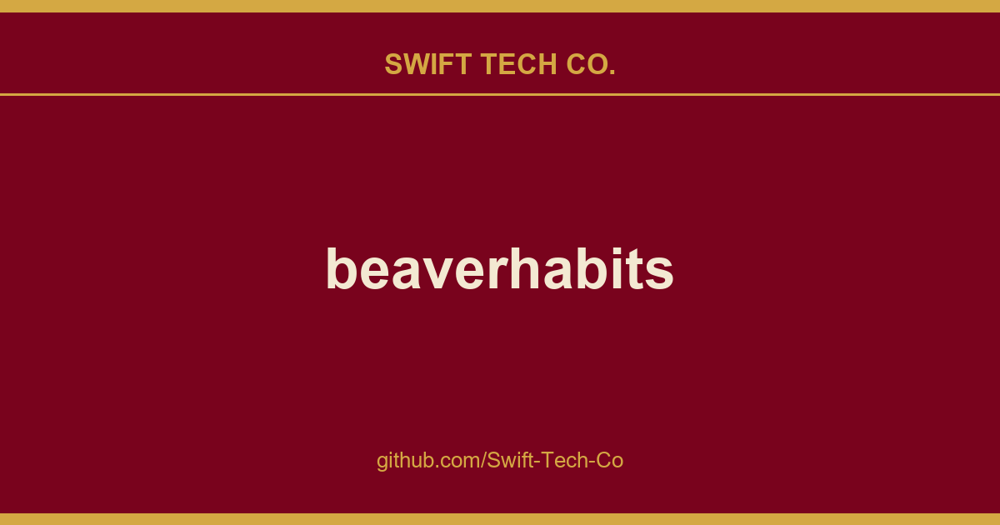

# beaverhabits

## What This Is

This is part of the Swift Tech Co. working stack for product and engineering. It gathers the beaverhabits notes, examples and fixes that keep delivery fast, and doubles as the reference map we hand to whoever picks up this thread next.

## Images

[](https://github.com/Swift-Tech-Co/beaverhabits)

## Cloud Service (SaaS)

Zero configuration, high availability, and low latency powered by global edge network.

- Demo: https://github.com/Swift-Tech-Co/beaverhabits
- Pricing Plans: https://github.com/Swift-Tech-Co/beaverhabits

## Self-Hosting

### Unraid

Simply search for "Beaver Habit Tracker" in the Community Apps store!

### Easypanel

Easypanel can deploy Beaver Habit Tracker with one click using its official template, which runs the Docker image above with a persistent volume for you.

### Ship with Docker

```bash
docker run -d --name beaverhabits \
  -u $(id -u):$(id -g) \
  -e HABITS_STORAGE=USER_DISK \
  -v ./beaver/:/app/.user/ \
  -p 8080:8080 \
  daya0576/beaverhabits:latest
```

Or Docker Compose:
```yaml
services:
  beaverhabits:
    container_name: beaverhabits
    user: 1000:1000 # User permissions of your docker or default user.
    environment:
      # See the link below to find all the environment variables
      # https://github.com/Swift-Tech-Co/beaverhabits
      - HABITS_STORAGE=USER_DISK # DATABASE stores in a single SQLite database named habits.db. USER_DISK option saves in a local json file.
      - TRUSTED_LOCAL_EMAIL=your@email.com # Skip authentication
      - INDEX_HABIT_DATE_COLUMNS=5 # Customize the date columns for the index page.
      - ENABLE_IOS_STANDALONE=true
    volumes:
      - ./beaver/:/app/.user/ # Change directory to match your docker file scheme.
    ports:
      - 8080:8080
    restart: unless-stopped
    image: daya0576/beaverhabits:latest
```

P.S. The container starts as nobody to increase the security and make it OpenShift compatible.
To avoid permission issues, ensure that the UID owning the host folder aligns with the UID of the user inside the container.

## Development

BeaverHabits favors uv as package management tool. Here is how to set up the development environment:

```sh
# Install uv and all the dependencies
uv venv && uv sync

# Start the server
./start.sh dev
```

# Features

For a complete list of features, please visit our Wiki page.

Inspired by:

---

## Swift Tech Co.

Built and maintained by Swift Tech Co.

AI Automation | FinTech Platforms | Custom Software and Mobile Apps | SaaS Platforms | Cloud Infrastructure | Cybersecurity | SEO and Marketing | API Integration

**Join our community on Telegram:** [t.me/+Qt_eFvkb2rliMzNh](https://t.me/+Qt_eFvkb2rliMzNh)

Home | Services | Careers | Referral Program | Influencers | About | Contact

**Connect**

- Website: https://github.com/Swift-Tech-Co/beaverhabits
- LinkedIn: [linkedin.com/in/stephenoladoke](https://www.linkedin.com/in/stephenoladoke/)
- LinkedIn (Company): [linkedin.com/company/swift-tech-co](https://www.linkedin.com/company/swift-tech-co)
- X: [@MrOladoke](https://x.com/MrOladoke)
- Instagram: [@mr.oladoke](https://www.instagram.com/mr.oladoke/)
- Organization: [github.com/Swift-Tech-Co](https://github.com/Swift-Tech-Co)

## Sources

Compiled and maintained from upstream [daya0576/beaverhabits](https://github.com/daya0576/beaverhabits) under permissive open-source license.

---

Maintained by [Swift Tech Co.](https://github.com/Swift-Tech-Co) - [Telegram](https://t.me/+Qt_eFvkb2rliMzNh)

## Sources

Compiled and maintained from upstream [daya0576/beaverhabits](https://github.com/daya0576/beaverhabits) under permissive open-source license.

---

Maintained by [Swift Tech Co.](https://github.com/Swift-Tech-Co) - [Telegram](https://t.me/+Qt_eFvkb2rliMzNh)

## Sources

Compiled and maintained from upstream [daya0576/beaverhabits](https://github.com/daya0576/beaverhabits) under permissive open-source license.

---

Maintained by [Swift Tech Co.](https://github.com/Swift-Tech-Co) - [Telegram](https://t.me/+Qt_eFvkb2rliMzNh)

## Sources

Compiled and maintained from upstream [daya0576/beaverhabits](https://github.com/daya0576/beaverhabits) under permissive open-source license.

---

Maintained by [Swift Tech Co.](https://github.com/Swift-Tech-Co) - [Telegram](https://t.me/+Qt_eFvkb2rliMzNh)

## Sources

Compiled and maintained from upstream [daya0576/beaverhabits](https://github.com/daya0576/beaverhabits) under permissive open-source license.

---

Maintained by [Swift Tech Co.](https://github.com/Swift-Tech-Co) - [Telegram](https://t.me/+Qt_eFvkb2rliMzNh)